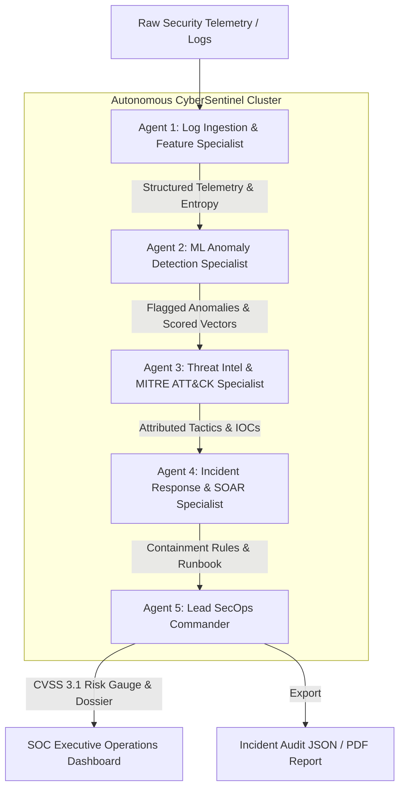

# 🛡️ CyberSentinel AI – Autonomous SecOps & Multi-Agent Threat Triage System

[](https://www.python.org/)
[](https://palletsprojects.com/p/flask/)
[](#multi-agent-architecture)
[](#machine-learning-engine)
[](https://attack.mitre.org/)
[](#ibm-internship-alignment)

> **CyberSentinel AI** is an enterprise-grade autonomous Security Operations Center (SOC) incident triage platform. Built on a cooperative multi-agent architecture and statistical/machine-learning anomaly vectorization, CyberSentinel AI ingests raw security telemetry, isolates anomalous behavior, attributes adversary TTPs to the **MITRE ATT&CK Enterprise Matrix**, calculates standardized **CVSS 3.1 threat severity scores**, synthesizes **machine-executable containment firewall rules**, and generates **CISO-ready executive incident dossiers**.

---

## 📌 Table of Contents
- [Executive Overview](#-executive-overview)
- [IBM Internship Alignment](#-ibm-internship-alignment)
- [Multi-Agent Architecture](#-multi-agent-architecture)
- [Machine Learning & Feature Engine](#-machine-learning--feature-engine)
- [Enterprise Attack Scenarios](#-pre-loaded-enterprise-attack-scenarios)
- [Project Directory Structure](#-project-structure)
- [Quick Start Guide](#-quick-start-guide)
- [How to Upload to Your GitHub Repository](#-how-to-upload-to-your-github-repository)
- [Screenshots & UI Showcase](#-ui-features)
- [License](#-license)

---

## 🌐 Executive Overview

Modern Security Operations Centers (SOCs) are overwhelmed by millions of alerts daily, leading to alert fatigue and delayed incident responses. **CyberSentinel AI** solves this through an autonomous **Multi-Agent Cooperative Pipeline**:

1. **Autonomous Log Ingestion & Tokenization**: Parses heterogeneous raw logs (Linux Auth, NGINX Web Server, Windows PowerShell, CloudTrail, Syslog) and computes temporal frequency & Shannon payload entropy.
2. **Machine Learning Anomaly Detection**: Unsupervised multivariate vectorization evaluates deviations from normal baselines and scores each event with anomaly confidence.
3. **Threat Attribution**: Correlates Indicators of Compromise (IOCs) directly with the **MITRE ATT&CK framework** (Tactics & Techniques like T1110, T1190, T1078, T1071).
4. **Automated Defensive Response**: Synthesizes ready-to-deploy Linux `iptables`, `UFW`, and `AWS WAF` perimeter drop rules.
5. **Executive Incident Synthesis**: Produces structured CISO briefings powered by Google Gemini (with full offline fallback capabilities).

---

## 🎯 IBM Internship Alignment

This project directly embodies the core pillars of the **IBM Machine Learning and Agentic AI** curriculum:

| IBM Curriculum Pillar | CyberSentinel AI Implementation |
| :--- | :--- |
| **Agentic AI & Orchestration** | 5 specialized agents collaborating sequentially with state passing, tool use, and validation. |
| **Machine Learning Core** | Unsupervised multivariate anomaly scoring, Shannon entropy extraction, and outlier decision boundaries. |
| **Enterprise Relevance** | Modeled directly after **IBM Security QRadar SIEM / SOAR / watsonx.ai** cybersecurity workflows. |
| **Explainable AI (XAI)** | Every flagged event provides explainability drivers detailing which features pushed the risk score. |
| **Robust Fallback Design** | 100% operational in offline/demo mode without external API dependencies. |

---

## 🤖 Multi-Agent Architecture

The system utilizes an orchestrator-directed pipeline where specialized autonomous agents perform dedicated operational tasks:



### Specialized Agents:
- **Agent 1: Log Ingestion & Feature Specialist**: Parses disparate log syntaxes, extracts IP entities, calculates Shannon entropy, and tracks burst rates.
- **Agent 2: ML Anomaly Specialist**: Executes multivariate scoring across length, entropy, failure patterns, and IP bursts.
- **Agent 3: Threat Intel & MITRE Specialist**: Maps signatures to MITRE ATT&CK techniques (T1110, T1190, T1078, etc.) and isolates malicious IOCs.
- **Agent 4: Incident Response Specialist**: Generates machine-executable firewall containment commands (`iptables`, `ufw`, `aws waf`) and 4-phase NIST SP 800-61 playbooks.
- **Agent 5: Lead SecOps Commander**: Computes unified CVSS 3.1 severity scores and synthesizes the CISO executive briefing.

---

## 🧠 Machine Learning & Feature Engine

### 1. Shannon Entropy Vectorization
Adversarial attacks frequently utilize obfuscation, base64 encoding, SQL injection keywords, or high-entropy tokens:
$$H(X) = -\sum_{i=1}^{n} P(x_i) \log_2 P(x_i)$$
CyberSentinel AI monitors entropy deltas across requests; an entropy score $> 4.2$ strongly signals obfuscated shell scripts, SQLi payloads, or C2 beacon data.

### 2. Multivariate Isolation Scoring
Features evaluated for each telemetry record:
- **Normalized Payload Length**: Identifies payload stuffing.
- **Shannon Entropy**: Measures randomness and encoding.
- **Signature Hit Weight**: Detects known exploit tokens (`union select`, `/etc/passwd`, `mimikatz`, `powershell -enc`).
- **Authentication Failure Flag**: Weighs credential stuffing.
- **IP Burst Ratio**: Measures automated scanning / brute force frequency.
- **Privilege Elevation Indicator**: Flags root escalation events.

---

## ⚡ Pre-loaded Enterprise Attack Scenarios

The web interface features 1-click execution for 5 realistic enterprise scenarios:

1. **Distributed SSH Brute Force (`ssh_bruteforce.log`)**:
   - Adversary dictionary attack targeting root, admin, oracle, and devops accounts.
   - MITRE ATT&CK: **T1110.001 (Brute Force: Password Guessing)**.
2. **SQL Injection & Data Exfiltration (`sqli_exfiltration.log`)**:
   - `sqlmap` automated extraction of user credentials and database tables via public API endpoints.
   - MITRE ATT&CK: **T1190 (Exploit Public-Facing Application)**.
3. **C2 Beaconing (`c2_beaconing.log`)**:
   - Regular, high-entropy outbound HTTP CONNECT requests to adversarial infrastructure.
   - MITRE ATT&CK: **T1071.001 (Application Layer Protocol: Web Protocols)**.
4. **Privilege Escalation (`privilege_escalation.log`)**:
   - Contractor account authentication failure, exploit execution, root elevation, and `/etc/shadow` theft.
   - MITRE ATT&CK: **T1078.003 (Valid Accounts: Local Accounts)**.
5. **Clean Baseline Traffic (`normal_traffic.log`)**:
   - Benign web traffic and authorized SSH key authentication to verify low false-positive rates.

---

## 📁 Project Structure

```text
CyberSentinel_AI/
├── app.py                      # Flask Application Server & REST Endpoints
├── config.py                   # Configuration and Environment Management
├── requirements.txt            # Python Dependencies
├── .env.example                # Environment Variable Template
├── .gitignore                  # Git Ignore Rules
├── README.md                   # Comprehensive System Documentation
│
├── agents/                     # Multi-Agent Core
│   ├── __init__.py
│   ├── orchestrator.py         # Lead SecOps Orchestrator & CVSS Scorer
│   ├── log_agent.py            # Log Ingestion & Feature Specialist
│   ├── ml_anomaly_agent.py     # ML Anomaly Detection Specialist
│   ├── threat_intel_agent.py   # MITRE ATT&CK & Threat Intel Specialist
│   └── response_agent.py       # Incident Response & Playbook Specialist
│
├── ml_engine/                  # ML & Feature Engineering Layer
│   ├── __init__.py
│   ├── feature_extractor.py    # Log Tokenizer, Shannon Entropy & IP Frequency
│   └── anomaly_detector.py     # Multivariate Isolation & Outlier Classifier
│
├── sample_logs/                # Enterprise Attack Scenario Telemetry
│   ├── ssh_bruteforce.log
│   ├── sqli_exfiltration.log
│   ├── c2_beaconing.log
│   ├── privilege_escalation.log
│   └── normal_traffic.log
│
├── templates/
│   └── index.html              # Dark SOC Command Operations Dashboard
│
└── static/
    ├── css/
    │   └── style.css           # Custom Glassmorphic Dark Cyber Ops Theme
    └── js/
        └── app.js              # Real-time UI, Agent Visualizer & Triage Engine
```

---

## 🚀 Quick Start Guide

### Prerequisites
- Python 3.10, 3.11, 3.12, 3.13, or 3.14
- Web Browser (Chrome, Firefox, Edge, Safari)

### Step 1: Navigate to the Project Directory
```bash
cd CyberSentinel_AI
```

### Step 2: (Recommended) Create a Virtual Environment
```bash
# Windows
python -m venv venv
venv\Scripts\activate

# macOS / Linux
python3 -m venv venv
source venv/bin/activate
```

### Step 3: Install Dependencies
```bash
pip install -r requirements.txt
```

### Step 4: (Optional) Configure Google Gemini API Key
Copy the `.env.example` file to `.env`:
```bash
cp .env.example .env
```
Add your free Gemini API key from [Google AI Studio](https://aistudio.google.com/app/apikey).  
*(Note: If no API key is provided, CyberSentinel AI automatically engages its internal Expert Knowledge Synthesizer, ensuring 100% full functionality!)*

### Step 5: Launch the Application
```bash
python app.py
```
Open your browser and navigate to:  
👉 **`http://127.0.0.1:5000`**

---

## 📤 How to Upload to Your GitHub Repository

Follow these step-by-step instructions to upload CyberSentinel AI to your own GitHub profile:

### 1. Create a New Repository on GitHub
1. Log in to [GitHub](https://github.com).
2. Click the **`+`** icon in the top right corner &rarr; **`New repository`**.
3. Set Repository name: `CyberSentinel-AI` (or your preferred name).
4. Description: `Autonomous SecOps Incident Triage & Multi-Agent Threat Intelligence System (IBM ML & Agentic AI)`.
5. Choose **Public**.
6. **Do NOT** check "Add a README file" (we already have a complete one).
7. Click **`Create repository`**.

### 2. Initialize Git and Push from Your Terminal
Open PowerShell or Command Prompt in the `CyberSentinel_AI` folder:

```bash
# 1. Ensure you are in the CyberSentinel_AI folder
cd "e:\SkillPath_AI-main\CyberSentinel_AI"

# 2. Initialize git repository
git init

# 3. Add all files to staging
git add .

# 4. Commit files
git commit -m "Initial commit: CyberSentinel AI Autonomous Multi-Agent SecOps System"

# 5. Rename default branch to main
git branch -M main

# 6. Add your GitHub repository remote (replace YOUR_USERNAME with your GitHub handle)
git remote add origin https://github.com/YOUR_USERNAME/CyberSentinel-AI.git

# 7. Push to GitHub
git push -u origin main
```

---

## 💻 UI Features

- **SOC Dark Ops Aesthetic**: Glassmorphic panels with `#00f0ff` neon cyan, `#00e676` emerald, and `#ff1744` crimson indicators.
- **Dynamic Multi-Agent Status Visualizer**: Live step-by-step progression of all 5 autonomous agents.
- **Interactive CVSS 3.1 Severity Gauge**: Circular animated SVG gauge color-coded by threat severity.
- **MITRE ATT&CK Cards**: Adversary tactic classification and technique mapping.
- **Defense Automation**: Copy-to-clipboard Linux `iptables`, `ufw`, and `aws waf` commands.
- **Export Capabilities**: 1-click JSON Incident Dossier export and print/PDF executive report generation.

---

## 📜 License
This project is open-source and available under the [MIT License](LICENSE).
